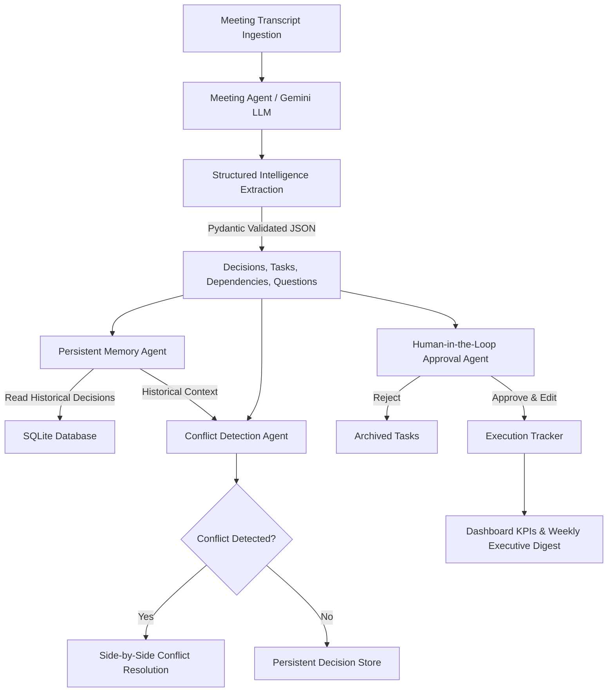

# ⚡ MeetFlow AI
> **From Meeting Conversations to Measurable Execution.**  
> *Autonomous Agentic Meeting-to-Execution SaaS Platform with Persistent Cross-Meeting Memory & Decision Conflict Detection.*

---

## 🎯 Executive Overview

Organizations conduct countless meetings, but critical decisions, assigned responsibilities, action items, and deadlines frequently vanish between conversations. Traditional meeting summarizers generate static bullet points that sit in inboxes without ensuring accountability or execution.

**MeetFlow AI** bridges this critical gap. It is an agentic productivity SaaS platform that transforms conversational transcripts into structured decisions, actionable tasks, persistent organizational memory, and verified execution workflows.

### 🌟 Core Differentiators
1. **Persistent Cross-Meeting Memory:** Maintains a persistent SQLite organizational decision store across application restarts.
2. **Decision Conflict Detection:** Compares newly proposed decisions against historical commitments to identify deadline shifts, contradictory policies, reassigned owners, and reversed decisions.
3. **Human-in-the-Loop Execution:** Enforces human review and approval before any extracted task enters the execution tracker.
4. **Execution Governance:** Tracks approved deliverables through *Not Started → In Progress → Completed* with active deadline monitoring and weekly executive digest synthesis.

---

## 🏗️ System Architecture



---

## 🛠️ Technology Stack

| Layer | Technology |
|---|---|
| **Frontend UI** | Streamlit, Custom CSS Design System, Responsive Dashboard |
| **Backend & Pipeline** | Python 3.13, Modular Agent Architecture |
| **AI & LLM** | Google Gemini API (`google-genai`), Structured JSON, Pydantic Schema Validation |
| **Resilience Engine** | Intelligent Deterministic Fallback Engine for instant offline/demo runs |
| **Storage & Memory** | SQLite (WAL Mode, persistent across restarts) |
| **Data Processing** | Pandas, Pydantic, Python datetime, UUID, python-dotenv |

---

## 📁 Project Directory Structure

```
MeetFlow AI/
├── app.py                      # Main Streamlit SaaS application & routing
├── requirements.txt            # Python dependencies
├── .env.example                # Template for environment configuration
├── .env                        # Local environment configuration
├── README.md                   # Complete documentation & demo walkthrough
├── meetflow/
│   ├── config.py               # Configuration & env management
│   ├── ai/
│   │   ├── extraction.py       # Gemini structured extraction & demo engine
│   │   ├── prompts.py          # AI prompt engineering templates
│   │   └── schemas.py          # Pydantic schemas (decisions, tasks, conflicts)
│   ├── agents/
│   │   ├── meeting_agent.py    # Transcript intelligence processor
│   │   ├── memory_agent.py     # Cross-meeting persistent memory retriever
│   │   ├── conflict_agent.py   # Decision conflict detection & analysis
│   │   └── execution_agent.py  # Human approval & execution tracking
│   ├── database/
│   │   ├── connection.py       # Thread-safe SQLite connection
│   │   ├── models.py           # Relational schema definitions
│   │   └── operations.py       # CRUD operations for meetings, decisions, tasks, conflicts
│   ├── services/
│   │   ├── meeting_service.py  # End-to-end ingestion pipeline
│   │   ├── memory_service.py   # Decision timeline & search
│   │   ├── conflict_service.py # Conflict resolution auditing
│   │   └── task_service.py     # Task approvals, metrics & digests
│   └── ui/
│       ├── styles.py           # Enterprise CSS typography, badges, glass cards
│       ├── dashboard.py        # Executive KPI dashboard
│       ├── new_meeting.py      # Meeting ingestion & quick-load demo buttons
│       ├── ai_insights.py      # AI extraction inspector & dependencies
│       ├── memory_view.py      # Persistent organizational memory timeline
│       ├── conflict_view.py    # Side-by-side conflict comparison & resolution
│       ├── approvals_view.py   # Human-in-the-loop task approval cards
│       ├── execution_view.py   # Execution tracker & status updates
│       └── digest_view.py      # Deadline monitor & executive digest generator
├── tests/
│   ├── test_extraction.py      # Pydantic validation & extraction tests
│   ├── test_memory.py          # SQLite persistence & query tests
│   └── test_conflicts.py       # Cross-meeting conflict detection scenario test
└── data/
    └── meetflow.db             # Persistent SQLite database
```

---

## 🚀 Quickstart & Installation

### 1. Prerequisites
- Python 3.10+ (Tested and verified on Python 3.13)

### 2. Install Dependencies
```bash
pip install -r requirements.txt
```

### 3. Configure API Credentials (Optional)
MeetFlow AI features an integrated **Demo Engine** so you can test all features immediately without any configuration. To activate live Gemini LLM extraction:

Copy `.env.example` to `.env` and insert your Gemini API Key:
```env
GEMINI_API_KEY=your_actual_gemini_api_key_here
GEMINI_MODEL=gemini-2.5-flash
MEETFLOW_DB_PATH=data/meetflow.db
```

### 4. Run the Application
```bash
streamlit run app.py
```
Or with specific Python interpreter:
```bash
python -m streamlit run app.py
```

The application opens at: `http://localhost:8501`

---

## 🧪 Automated Test Execution

Run the complete test suite verifying extraction, persistent memory, and cross-meeting conflict detection:

```bash
python tests/test_extraction.py
python tests/test_memory.py
python tests/test_conflicts.py
```

**Results:**
- `test_extraction.py`: Passed (Validates structured summary, decisions, action items, dependencies, and questions).
- `test_memory.py`: Passed (Validates SQLite relational persistence across connections).
- `test_conflicts.py`: Passed (Validates Meeting 1 -> Meeting 2 launch date change detection and conflict resolution).

---

## 🎬 3-Minute Hackathon Demonstration Script

Follow these steps to demonstrate MeetFlow AI's full power to judges in under 3 minutes:

### Step 1: Open the Application
1. Launch `streamlit run app.py`.
2. Notice the clean enterprise dark UI, executive KPIs, and persistent memory indicators.

### Step 2: Ingest Meeting 1 (Product Launch Planning)
1. In the sidebar, navigate to **2. New Meeting**.
2. Click the quick button: **"🚀 Load Meeting 1: Product Launch Planning"**.
3. Notice the pre-filled transcript:
   - Launch date set to **December 10**.
   - Developer commits to authentication by **December 5**.
   - Marketing commits to promotion by **December 8**.
4. Click **"🚀 Process Transcript with MeetFlow AI"**.
5. The application extracts the intelligence, stores decisions in SQLite memory, and redirects to **3. AI Insights**.

### Step 3: Verify Human-in-the-Loop Task Approvals
1. In the sidebar, navigate to **6. Task Approvals**.
2. Notice that tasks are **NOT** automatically executed. They require explicit human approval.
3. Review and click **"✅ Approve All Pending Tasks"** (or edit individual deadlines/owners).
4. Navigate to **7. Execution Tracker** to verify that only approved tasks now appear in execution.

### Step 4: Ingest Meeting 2 & Witness Conflict Detection (The Core Innovation)
1. Navigate back to **2. New Meeting**.
2. Click the quick button: **"🔄 Load Meeting 2: Product Launch Review (Conflict Scenario)"**.
3. Notice the transcript:
   - Manager announces: *"Due to development delays, we are postponing the product launch to December 15."*
4. Click **"🚀 Process Transcript with MeetFlow AI"**.
5. **Conflict Alert Triggers!** The application automatically detects that December 15 contradicts the historical December 10 decision from Meeting 1.
6. The app automatically navigates to **5. Conflict Detection**, displaying:
   - **Conflict Type:** `Deadline Modification`
   - **Historical Decision in Memory:** `Product launch scheduled for December 10.`
   - **Proposed New Decision:** `Product launch is postponed to December 15.`
   - **Recommended Action:** `Review and confirm the updated launch decision...`
7. Click **"✅ Confirm Update"**.
8. Notice that the historical decision is now cleanly marked as `Superseded` and the new decision becomes active.

### Step 5: Executive Synthesis
1. Navigate to **8. Executive Digest**.
2. Click **"✨ Synthesize Executive Weekly Digest"** to view the consolidated report and download as Markdown.
3. Return to **1. Overview** to see the updated metrics showing completed tasks and resolved conflicts!

---

## 🔒 Security & Privacy
- API keys are managed exclusively via environment variables (`.env`).
- Never exposed in frontend or client-side storage.
- Local SQLite database ensures sensitive meeting discussions remain on your infrastructure.
# MeetFlow-AI

